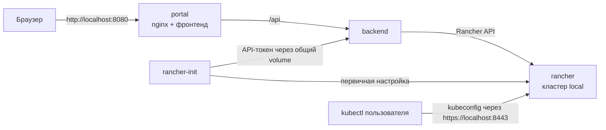
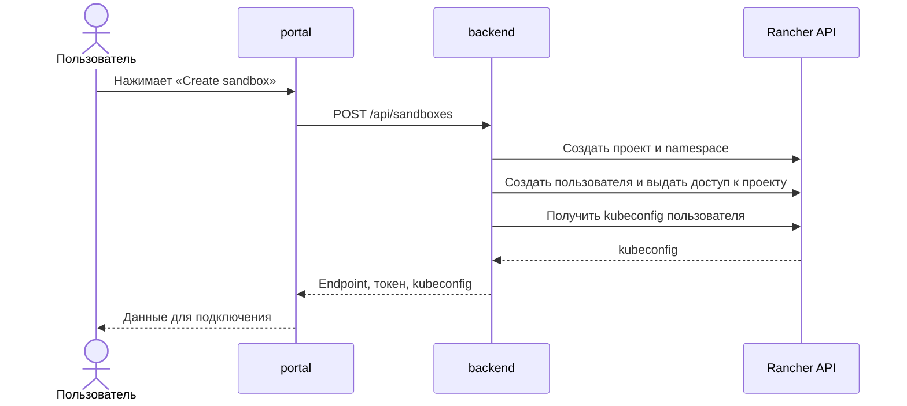

# Портал запроса Kubernetes-песочниц

Учебный продуктовый проект в формате «учимся, создавая»: веб-портал, через
который пользователь может запросить изолированное Kubernetes-окружение
(песочницу) для запуска своего приложения.

> [!IMPORTANT]
> Репозиторий находится в начале реализации. Сейчас в нём есть запуск Rancher
> в Docker и каркас бэкенда на FastAPI. Сервисы `portal`, `rancher-init`, API
> песочниц и фронтенд ещё не реализованы. Команды и адреса ниже описывают
> **целевое состояние MVP**; фактический прогресс — в разделе
> [«Текущее состояние»](#текущее-состояние).

## Содержание

- [Цель](#цель)
- [Ключевое требование: только Docker](#ключевое-требование-только-docker)
- [Требования к хосту](#требования-к-хосту)
- [Быстрый старт](#быстрый-старт)
- [Адреса после запуска](#адреса-после-запуска)
- [Использование песочницы](#использование-песочницы)
- [Что такое песочница](#что-такое-песочница)
- [Архитектура](#архитектура)
- [MVP](#mvp)
- [Документация](#документация)
- [Тесты](#тесты)
- [Решение проблем](#решение-проблем)
- [Подход](#подход)
- [Сроки и инструменты](#сроки-и-инструменты)
- [Структура репозитория](#структура-репозитория)
- [Текущее состояние](#текущее-состояние)

## Цель

Сделать работающий портал, в котором пользователь одним
нажатием получает Kubernetes-песочницу и данные для подключения к ней.

### Ключевое требование: только Docker

Все компоненты, включая Rancher, работают в обычном Docker. Весь проект
поднимается **одной командой** вместе со сборкой:

```bash
docker compose up --build
```

### Требования к хосту

- Docker Engine или Docker Desktop с Compose v2;
- разрешены привилегированные контейнеры (Rancher в Docker без этого не
  работает; rootless Docker и Podman могут не подойти);
- Docker доступно не меньше 6–8 ГБ ОЗУ.

## Быстрый старт

> Целевой сценарий MVP. Пока в `docker-compose.yaml` описан только Rancher,
> поэтому сейчас команда поднимает только его.

```bash
docker compose up --build          # первый запуск занимает несколько минут (настройка Rancher)
# или: docker compose up --build -d --wait   (возвращает управление, когда все сервисы healthy)
```

1. Откройте <http://localhost:8080> и нажмите **Create sandbox**.
2. Скачайте kubeconfig (токен показывается только один раз).
3. Используйте его с хоста:

   ```bash
   export KUBECONFIG=$PWD/sandbox-<id>.kubeconfig.yaml
   kubectl -n sandbox-<id> create deployment web --image=nginx
   kubectl -n sandbox-<id> get pods
   kubectl get namespaces            # Forbidden: доступ ограничен namespace песочницы
   ```

То же самое без UI:

```bash
curl -s -X POST http://localhost:8080/api/sandboxes
# {"id": "...", "namespace": "sandbox-...", "status": "ready",
#  "endpoint": "https://localhost:8443/k8s/clusters/local",
#  "token": "kubeconfig-u-...", "kubeconfig": "...", "created_at": "..."}
```

В UI Rancher по адресу <https://localhost:8443> можно войти как
`admin` / `local-dev-only-change-me` (только для локальной разработки;
переопределяется через `RANCHER_BOOTSTRAP_PASSWORD`). Браузер предупредит о
самоподписанном сертификате — это ожидаемо.

Полный сброс:

```bash
docker compose down -v
```

У всех настроек есть значения по умолчанию. Что можно переопределить, описано
в [`.env.example`](.env.example).

## Адреса после запуска

| Что | Адрес |
| --- | --- |
| Портал | <http://localhost:8080> |
| UI Rancher (для исследования и отладки) | <https://localhost:8443> |

## Использование песочницы

После создания песочницы портал отдаёт:

- `id` — идентификатор песочницы;
- `namespace` — namespace в кластере `local`;
- `status` — состояние (`ready`, `failed`, ...);
- `endpoint` — адрес Kubernetes API для kubeconfig;
- `token` — токен пользователя песочницы (показывается один раз);
- `kubeconfig` — готовый kubeconfig для скачивания;
- `created_at` — время создания.

Дальше пользователь работает обычным `kubectl`, не имея доступа к другим
namespace и к ресурсам кластера.

## Что такое песочница

Создавать полноценный отдельный Kubernetes-кластер на каждый запрос в обычном
Docker непрактично. Поэтому в MVP песочница — это:

- **проект Rancher** во встроенном кластере `local`;
- **namespace** внутри этого проекта;
- **отдельный пользователь Rancher** с правами только на этот проект;
- **kubeconfig** этого пользователя, который выдаёт портал.

В kubeconfig есть и endpoint, и токен, поэтому пользователь может сразу начать
работать с песочницей через `kubectl`. Точную последовательность вызовов API
команда исследует сама; текущие заметки — в
[`docs/rancher-api.md`](docs/rancher-api.md).

Изоляция в MVP — на уровне namespace и RBAC, а не отдельной виртуальной
машины: все песочницы живут в общем кластере `local`. Это осознанный
компромисс, зафиксированный в
[ADR 0001](docs/decisions/0001-sandbox-model.md).

## Архитектура

| Сервис | Назначение | Порт на хосте |
| --- | --- | --- |
| `portal` | nginx: раздаёт собранный фронтенд и проксирует `/api` в бэкенд | 8080 |
| `backend` | API портала; единственный компонент, который обращается к Rancher | не публикуется |
| `rancher` | Rancher со встроенным кластером `local`; данные в именованном volume | 8443 |
| `rancher-init` | Одноразовый контейнер: ждёт Rancher, выполняет первичную настройку, выпускает API-токен для бэкенда | — |





## MVP

1. **Исследование Rancher API**: какие вызовы нужны, чтобы создать песочницу и
   выдать к ней доступ.
2. **Автоматический запуск**: `docker compose up --build` поднимает всё,
   включая первичную настройку Rancher.
3. **Создание песочницы в бэкенде**: проект, namespace, пользователь, права,
   kubeconfig.
4. **Фронтенд**: страница с кнопкой «Create sandbox».
5. **Выдача результата**: endpoint, токен и kubeconfig для скачивания.

### Вне рамок MVP

- аутентификация пользователей портала;
- сложный интерфейс;
- база данных (состояние песочниц хранится в самом Rancher в виде меток);
- удаление по TTL, квоты, дополнительные модули.

### Возможные следующие шаги

- квоты ресурсов на проект песочницы;
- удаление песочниц и автоматическая очистка по сроку жизни;
- отдельный k3s-кластер в соседнем контейнере, импортированный в Rancher,
  чтобы отделить управление от пользовательских нагрузок;
- аутентификация пользователей портала.

## Документация

- [`docs/rancher-api.md`](docs/rancher-api.md) — исследование Rancher API: все
  используемые вызовы, форматы запросов и ответов, подводные камни, выводы о
  минимальных привилегиях.
- [`docs/decisions/0001-sandbox-model.md`](docs/decisions/0001-sandbox-model.md)
  — что такое песочница и какую роль получает её пользователь.
- [`docs/decisions/0002-bootstrap-and-tls.md`](docs/decisions/0002-bootstrap-and-tls.md)
  — автоматическая настройка Rancher, работа с токеном и доверие TLS.
- [`docs/case.md`](docs/case.md) — карточка кейса для студентов.
- [`AGENTS.md`](AGENTS.md) — правила архитектуры и соглашения для участников.

## Тесты

Команды ниже описывают целевое состояние: профили `test` в `docker-compose.yaml`
появятся вместе с сервисами `backend-tests` и `frontend-tests`.

```bash
docker compose --profile test run --rm --build backend-tests    # ruff + pytest (Rancher замокан через respx)
docker compose --profile test run --rm --build frontend-tests   # eslint + prettier + tsc + vitest

# end-to-end smoke-тест против запущенного стека
docker compose --profile test run --rm --build -e E2E_PORTAL_URL=http://portal backend-tests pytest tests/e2e
```

## Решение проблем

| Симптом | Что делать |
| --- | --- |
| `rancher` не становится healthy | Выделите Docker не меньше 6–8 ГБ ОЗУ; смотрите `docker compose logs rancher`. Привилегированные контейнеры должны быть разрешены. |
| `rancher-init` падает с «admin login failed» | Пароль администратора сменили в UI, а volume с токеном потерян. Выполните `docker compose down -v`. |
| Порт 8080 или 8443 занят | `PORTAL_PORT=9080 RANCHER_PORT=9443 docker compose up --build` (URL в kubeconfig следует за `RANCHER_PORT`). |
| Браузер ругается на сертификат Rancher | Самоподписанный сертификат; для локальной разработки это ожидаемо. Не отключайте проверку TLS в production-сценариях. |
| `kubectl` получает `Forbidden` на чужие namespace | Так и должно быть: доступ песочницы ограничен её проектом и namespace. |

## Структура репозитория

Текущая структура:

```text
.
├── backend/              # каркас API на FastAPI (src-layout)
├── Rancher_init/         # вспомогательные материалы для запуска Rancher
├── docs/                 # исследование, ADR и карточка кейса
├── docker-compose.yaml   # пока описывает только Rancher
└── .env.example          # переопределяемые настройки
```

Целевая структура MVP:

```text
.
├── backend/              # FastAPI: API портала и клиент Rancher
├── frontend/             # SPA с кнопкой «Create sandbox»
├── portal/               # nginx: статика фронтенда и прокси /api
├── rancher-init/         # одноразовая настройка Rancher и выпуск токена
├── docs/                 # документация проекта
├── docker-compose.yaml   # все сервисы, healthcheck'и и профиль test
└── .env.example          # значения по умолчанию и переопределения
```

## Текущее состояние

| Компонент | Статус |
| --- | --- |
| `docker-compose.yaml` с Rancher | ✅ есть (только Rancher) |
| Каркас бэкенда FastAPI | ✅ есть (`backend/`) |
| `rancher-init` | ⏳ не реализован |
| API создания песочниц | ⏳ не реализовано |
| Фронтенд и `portal` | ⏳ не реализованы |
| Профиль `test` и e2e | ⏳ не реализованы |
| Документация | ✅ этот README, `docs/`, `AGENTS.md` |

## Лицензия

Проект распространяется по лицензии Apache 2.0 — см. [`LICENSE`](LICENSE).
