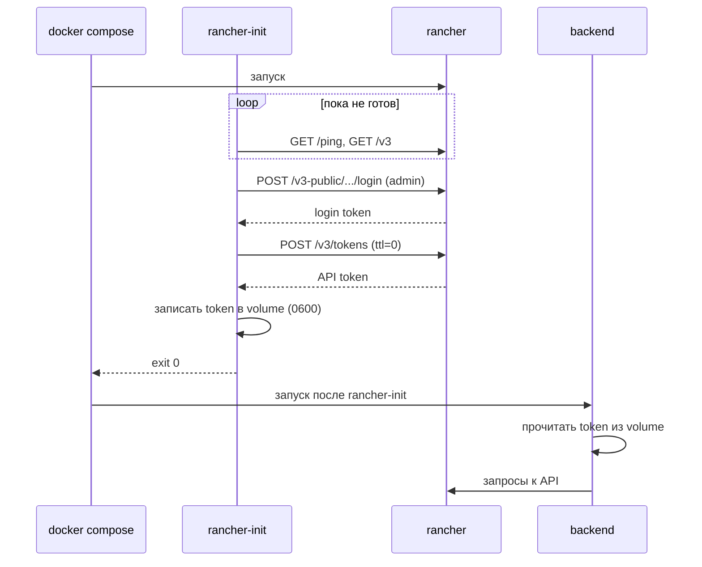

# ADR 0002: Автоматическая настройка Rancher и TLS

- **Статус:** принято для MVP
- **Дата:** 2026-11-17
- **Контекст:** проект «Портал запроса Kubernetes-песочниц»

## Контекст

Требование проекта: после `docker compose up --build` на чистой машине не
должно быть ручных шагов. При этом Rancher при первом запуске:

- несколько минут инициализируется и провижинит встроенный кластер `local`;
- требует логин администратора, чтобы выпустить API-токен;
- использует самоподписанный TLS-сертификат;
- хранит пароль администратора и состояние в volume.

Бэкенду нужен токен Rancher до того, как он начнёт принимать запросы. Если
создавать токен вручную через UI, требование «одна команда» нарушается.

## Решение

Добавляем одноразовый сервис `rancher-init`, который выполняется до старта
бэкенда:

1. ждёт готовности Rancher (`/ping`, затем `/v3`);
2. логинится администратором с паролем из `RANCHER_BOOTSTRAP_PASSWORD`;
3. выпускает долгоживущий API-токен через `POST /v3/tokens` (`ttl: 0`);
4. сохраняет токен в общий volume (файл с правами `0600`);
5. завершается с кодом `0`.

Бэкенд стартует после успешного завершения `rancher-init`
(`depends_on: service_completed_successfully`) и читает токен из того же
volume. Токен не передаётся через переменные окружения и не попадает в логи.

Для TLS в локальном окружении:

- клиенты внутри Docker-сети обращаются к `https://rancher:443`;
- браузер и `kubectl` с хоста — к `https://localhost:${RANCHER_PORT}`;
- самоподписанный сертификат принимается осознанно: в скриптах `curl -k`, в
  kubeconfig — `insecure-skip-tls-verify: true` либо CA Rancher в
  `certificate-authority-data`;
- отключение проверки TLS допускается только для локального стенда.

## Почему так

- **Ноль ручных шагов.** Пользователь не заходит в UI Rancher для настройки.
- **Токен не в env.** Файл в volume проще защитить от случайного вывода в
  `docker compose config` и логи.
- **Идемпотентность.** Если файл токена уже существует и токен валиден,
  `rancher-init` может пропустить создание нового.
- **Понятный порядок старта.** `service_completed_successfully` гарантирует,
  что бэкенд не начнёт работу без токена.
- **Локальный TLS-компромисс.** Не требует CA-инфраструктуры, но явно
  ограничен локальной разработкой.

## Последствия

### Положительные

- `docker compose up --build` — единственная необходимая команда.
- Нет ручного копирования токена.
- Ошибки инициализации видны в логах отдельного сервиса.
- Секрет не хранится в Git и не дублируется в переменных окружения.

### Отрицательные и риски

- **Долгий первый запуск.** Rancher и кластер `local` поднимаются минутами;
  нужны healthcheck'и и `start_period`.
- **Связка с volume.** Если volume Rancher сохранён, а volume с токеном
  потерян, автоматический логин может упасть после смены пароля в UI.
  Лечение — `docker compose down -v`.
- **Смена пароля.** `RANCHER_BOOTSTRAP_PASSWORD` действует только при первой
  инициализации; изменение переменной не меняет пароль в существующем volume.
- **Admin-токен.** В MVP он широкий по правам; компрометация токена означает
  компрометацию Rancher.
- **Самоподписанный сертификат.** Браузеры и `kubectl` требуют явного доверия
  или отключения проверки.
- **Endpoint в kubeconfig.** Rancher может вернуть внутренний адрес
  `https://rancher:443`; его нужно заменить на доступный с хоста.

## Рассмотренные альтернативы

| Вариант | Почему не выбран |
| --- | --- |
| Ручная настройка через UI Rancher | Нарушает требование «одна команда» |
| Передавать токен через переменную окружения | Секрет попадает в `docker compose config`, логи и окружение контейнеров |
| Встроить инициализацию в бэкенд при старте | Смешивает ответственность; сложнее повторить и отладить |
| Свой CA / cert-manager | Избыточно для локального MVP |
| Отключить TLS в Rancher | Небезопасно и не отражает реальное поведение |

## Обработка ошибок и восстановление

| Ситуация | Поведение |
| --- | --- |
| Rancher ещё не готов | `rancher-init` повторяет проверки с задержкой |
| Неверный пароль администратора | `rancher-init` падает с понятной ошибкой; нужен `down -v` |
| Файл токена уже есть | Проверить токен через API; при валидности — пропустить создание |
| Файл токена повреждён | Удалить файл и перезапустить `rancher-init` |
| Порт 8443 занят | Задать `RANCHER_PORT`, endpoint в kubeconfig должен следовать за ним |
| Rancher пересоздан | `docker compose down -v`, затем снова `up --build` |

## Открытые вопросы

- Нужен ли отдельный непривилегированный пользователь Rancher для бэкенда
  вместо admin-токена.
- Как автоматически проверять валидность сохранённого токена при старте.
- Нужен ли `CATTLE_SERVER_URL`, чтобы Rancher сразу генерировал публичный
  endpoint в kubeconfig.
- Как поступать с CA Rancher в более production-подобном сценарии.

## Ссылки

- [`../rancher-api.md`](../rancher-api.md) — вызовы логина и выпуска токена.
- [ADR 0001](0001-sandbox-model.md) — модель песочницы.
